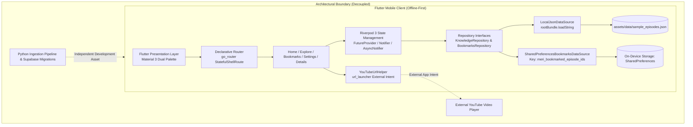

# Meri — The Business Behind the Story

Meri is an editorial companion application designed for Android that distills structured business knowledge from long-form Ethiopian entrepreneur and operator interviews. Rather than replacing full-length recordings, Meri translates extensive conversations into concise, structured knowledge briefings containing guest backgrounds, strategic insights, practical lessons, original Amharic quotations in authentic Ethiopic typography, and deep-linked timestamp references to the original YouTube broadcasts.

> **Note**: Meri is an offline-first reading companion. It does not automatically transcribe, summarize live YouTube video streams, or poll live podcast feeds over the network.

---

## Project Demo

Watch the Meri Android app demonstration to see the current experience, including the featured episode, business insights, Amharic quotations, Explore, bookmarks, and source-interview navigation.

[**▶ Watch the Meri Demo Video**](docs/media/meri-demo.mp4)

*The demonstration shows the current MVP, which uses a locally bundled episode dataset.*

---

## Current Features

All features listed below are implemented and verified in the application source code:

- **Editorial Home Screen & Masterclass Spotlight**: Features the active interview with an editorial masthead, guest dossier summary, formatted duration, and vertically flowing strategic takeaways with interactive detail bottom sheets.
- **Explore Search & Thematic Filtering**: Real-time client-side search across entrepreneur names, companies, industries, and takeaway text, combined with dynamic topic filter chips extracted directly from loaded content. Includes a dedicated empty-state interface with a filter reset action.
- **Episode Detail Dossier**: Comprehensive briefing view displaying guest biography, industry classifications, executive summaries, numbered strategic lessons with key takeaway bullet points, and actionable implementation callouts.
- **Primary Amharic Quotations**: Authentic upright Ethiopic script typography for original spoken quotations, accompanied by optional English translations and contextual notes.
- **Timestamped Video Deep-Linking**: Source validation via `YouTubeUrlHelper`, formatting and launching external playback at the exact second (`t=Xs`) where the quotation was spoken.
- **Local Notebook Bookmarking**: Fast, optimistic bookmark toggling stored on-device via `SharedPreferences` (storage key: `meri_bookmarked_episode_ids`). The Bookmarks tab provides an indexed list of saved interviews with graceful handling of deleted or unresolvable records.
- **Adaptive Dual Palette**: Material 3 Warm Ivory (`#F7F3EB`) light mode and Ink Black (`#191A18`) dark mode designed for reading comfort, automatically harmonizing with the host device's system appearance.
- **Native Android App Identity**: Adaptive launcher icon (`ic_launcher.xml` with background `#191A18`, foreground, and monochrome vectors), legacy density icons (mdpi through xxxhdpi), and dedicated light/dark splash screens with Android 12+ (API 31+) splash configuration.

---

## Current Dataset

The mobile application currently ships with **one featured episode**:

- **Episode #199**: *Turning Makeup into an Enterprise: Vocational Education & Brand Building*
- **Featured Guest**: **Wengelawit (Liya) Gole**, Founder & CEO of International Makeup School (IMS) and Dura by Liya.
- **Source Interview**: [YouTube: Meri Podcast Episode 199](https://www.youtube.com/watch?v=wohjyv428Us) (`wohjyv428Us`)
- **Quotation Provenance**: Direct Amharic quotations and timestamps are cross-referenced against the raw YouTube caption track ([data/transcripts/wohjyv428Us.am-orig.vtt](data/transcripts/wohjyv428Us.am-orig.vtt)) at 00:01:05 (65s), 00:00:56 (56s), and 00:03:25 (205s).

The dataset is bundled locally in [assets/data/sample_episodes.json](assets/data/sample_episodes.json). Because the archive currently contains this single featured episode, the Home screen's secondary archive section displays a thematic topic exploration card, and Explore filtering operates across the tags and categories of this record.

---

## Architecture

The mobile client follows clean architecture principles, separating user interface, state management, and data sources:



### Mobile Data Flow
1. **Startup**: [lib/main.dart](lib/main.dart) initializes the Riverpod `ProviderScope`. [lib/app/app.dart](lib/app/app.dart) configures `MaterialApp.router` with `AppTheme` and `appRouter`.
2. **Routing**: [lib/app/router.dart](lib/app/router.dart) sets up `go_router` with a `StatefulShellRoute.indexedStack` managing 4 persistent bottom navigation destinations (`/`, `/explore`, `/bookmarks`, `/settings`) and a root `/episode/:id` route.
3. **Data Loading**: `LocalKnowledgeRepository` loads and decodes the bundled JSON archive via `LocalJsonDataSource`, caching the parsed domain models in memory.
4. **Notebook Persistence**: `BookmarksNotifier` executes optimistic state updates and persists episode IDs to `SharedPreferences` under key `meri_bookmarked_episode_ids`.
5. **External Media**: `YouTubeUrlHelper` validates URLs and delegates playback to external applications via `url_launcher`.

### Ingestion Pipeline Boundary
The repository includes a backend ingestion pipeline ([backend/](backend/)) and PostgreSQL migration files ([supabase/migrations/](supabase/migrations/)). **The mobile client is strictly decoupled from this infrastructure**:
- The mobile app does not include `supabase_flutter` and performs zero network requests to Supabase at runtime.
- The backend pipeline operates as an independent developer toolchain for processing transcripts and generating structured candidates.

---

## Technology Stack

### Mobile Application
- **Framework**: Flutter 3.x (Dart SDK `^3.12.2`)
- **State Management**: `flutter_riverpod: ^3.4.3`
- **Declarative Routing**: `go_router: ^17.5.0`
- **Local Persistence**: `shared_preferences: ^2.5.6`
- **Typography & Styling**: `google_fonts: ^8.2.1` (Playfair Display, Inter), `cupertino_icons: ^1.0.8`
- **Utilities**: `intl: ^0.20.3`, `url_launcher: ^6.3.3`
- **Android Target**: Android SDK Min 21, Target 34, Android 12+ (API 31+) Splash API

### Backend Ingestion Pipeline (Separate Toolchain)
- **Language**: Python 3.12+
- **Database Schema**: PostgreSQL 15+ (10 tables, triggers, RLS, and review RPCs across 3 Supabase migrations)
- **AI Extraction Schema**: Gemini Extraction Schema v1.0.0 ([backend/schemas/gemini_extraction_schema.v1.json](backend/schemas/gemini_extraction_schema.v1.json))

---

## Getting Started

### Prerequisites
- [Flutter SDK](https://docs.flutter.dev/get-started/install) (version 3.x compatible with Dart `^3.12.2`)
- Android Studio or Android SDK with platform tools (API level 21+)
- A physical Android device or Android emulator (required for verifying native splash screens and launcher icons)

### Running the Mobile Application

```bash
# 1. Fetch package dependencies
flutter pub get

# 2. Run static analysis (expected: 0 issues)
flutter analyze

# 3. Execute the automated mobile test suite
flutter test

# 4. Launch the application on a connected device or emulator
flutter run
```

> **Note**: These commands build and run the local mobile client. They do not deploy backend cloud services or require remote database credentials.

---

## Backend Content Pipeline

A separate Python pipeline exists under [backend/](backend/) for offline ingestion and verification of long-form interview transcripts:

- **Modules**: VTT/SRT transcript parsing, rolling caption reconstruction, segment normalization, context chunking, Google Gemini extraction client, dual syntactic/semantic validation, candidate reconciliation, and database persistence.
- **Database Migrations**: Three migration scripts under [supabase/migrations/](supabase/migrations/) establishing table schemas, Row-Level Security, quotation provenance triggers, and editorial review locking functions.
- **Backend Tests**: 294 unit and contract tests covering chunking, normalization, parsing, schema compliance, and CLI workflows.

To run the backend test suite:
```bash
python3 -m unittest discover -s backend/tests -p "test_*.py"
```

The pipeline is currently maintained as a local developer CLI and verification suite; it is not deployed as a continuous cloud worker service.

---

## Quality Checks

The following automated baseline was verified during the pre-submission audit:

- **Flutter Analysis**: Clean run with 0 issues (`flutter analyze`).
- **Flutter Test Suite**: 124 tests passing across 18 test files (`flutter test`).
- **Android APK Build**: Successful debug APK build (`flutter build apk --debug`, output at `build/app/outputs/flutter-apk/app-debug.apk`).
- **Backend Test Suite**: 294 tests passing across the Python test discovery suite.
- **Git Diff**: Clean formatting verified via `git diff --check`.

*(This baseline reflects the local development environment; individual build times and font cache logs may vary by machine).*

---

## Limitations

- **Single Episode Dataset**: The bundled archive contains only Episode #199. Multi-episode archive browsing and cross-episode comparison are planned for subsequent editions.
- **No Live Sync**: The mobile client functions completely offline and does not synchronize with live Supabase databases or external podcast APIs.
- **External Playback Dependency**: Full-length video and quotation timestamps open in an external YouTube player or browser and require an active internet connection.
- **Audio Streaming Dormant**: While the data model supports an `audioUrl` field, streaming audio playback is not active in this release.

---

## Screenshots


*Screenshots from a physical Android device will be added prior to production release.*
