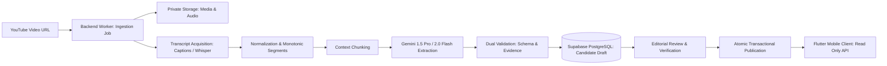

# Meri Content Pipeline: Architecture & Foundation Design

## 1. Executive Summary & Objective

**Meri** is an editorial platform capturing masterclass-grade business wisdom from Ethiopia's leading entrepreneurs and operators. Long-form video interviews (often 60–120+ minutes) contain dense, nuanced strategic knowledge, market realities, and original Amharic idioms.

This architecture establishes a **transcript-first, verifiable content ingestion pipeline**. Raw video/audio is treated as source media, transcripts form the ground truth, and Gemini AI extracts structured candidate insights, quotations, and guest profiles. No content is published to mobile users without passing both schema verification and human editorial sign-off.

---

## 2. Architectural Principles

1. **Transcript-First Ground Truth**: Every extracted insight, operational milestone, and quotation MUST point directly to verified transcript segments. Claims cannot exist without backing segment citations.
2. **Strict Separation of Ingestion vs. Publication**: Background worker processing status (`pending`, `processing`, `completed`, `failed`) is completely separated from episode publication status (`draft`, `in_review`, `published`, `archived`). A failed job does not corrupt published content.
3. **No Heavy Media in PostgreSQL**: Large video or raw WAV/MP3 files are NEVER stored in the database. Media is held in private object storage (e.g. Supabase Storage / S3) with expiring presigned URLs used strictly during processing.
4. **Idempotency & Reversibility**: Each processing stage (metadata, transcript fetch, normalization, chunking, extraction) can be safely retried without side effects or duplicate record generation.
5. **No Hallucinated Timestamps**: AI models are forbidden from inventing quotation timestamps. Timestamps are derived deterministically from the start millisecond (`start_ms / 1000`) of the matching transcript segment.
6. **Dual Validation Doctrine**:
   - *Phase 1 (Syntactic)*: Strict JSON schema conformance.
   - *Phase 2 (Semantic Evidence)*: Verification that referenced segment IDs exist, timestamps fall within segment boundaries, and Amharic text matches transcript segments.
7. **Mobile Client Continuity**: Existing Flutter models, UI presentations, and local SharedPreferences bookmarks remain fully compatible and functional.

---

## 3. Storage & Infrastructure Architecture

| Layer | Technology | Purpose & Access Control |
| :--- | :--- | :--- |
| **Relational Database** | Supabase PostgreSQL 15+ | Relational data, normalized segments, chunks, extraction history, verified insights, Row Level Security. |
| **Object Storage** | Supabase Storage (Private Bucket: `meri-media-raw`) | Temporary storage for downloaded audio/video artifacts. Access via expiring presigned URLs; auto-purged post-transcription. |
| **Worker Environment** | Node.js / Python / Go worker (Isolated service) | Background processing worker running asynchronous stages. Uses `service_role` credentials; isolated from client apps. |
| **AI Inference** | Google Gemini 1.5 Pro / 2.0 Flash (Vertex AI / AI Studio API) | Structured JSON extraction utilizing temperature `0.1` and system instructions enforcing evidence constraints. |
| **Client Application** | Flutter 3.x (iOS & Android) | Read-only access through public Supabase endpoints/RPCs. Consumes verified published episodes and bookmarks. |

---

## 4. Security Architecture & Threat Model

### 4.1 Secrets Protection
- **No Client Secrets**: Neither the Gemini API key nor the Supabase `service_role` secret is ever packaged inside or accessible to the Flutter mobile application.
- **Worker Isolation**: Ingestion worker runs in a secure VPC/container using environment variables injected at deployment.

### 4.2 Row-Level Security (RLS) Boundaries
Row Level Security is enabled across all 9 database tables:
- **Public `anon` & `authenticated` roles**:
  - `episodes`: `SELECT` ONLY WHERE `publication_status = 'published'` AND `published_at <= now()`.
  - `guests`: `SELECT` ONLY WHERE linked to at least one published episode.
  - `insights`: `SELECT` ONLY WHERE `review_status = 'verified'` AND `episode_id` is published.
  - `quotations`: `SELECT` ONLY WHERE `review_status = 'verified'` AND `episode_id` is published.
- **Private Tables (`processing_jobs`, `transcript_segments`, `transcript_chunks`, `extraction_runs`, `insight_evidence`)**:
  - Completely invisible to public roles.
  - Only accessible to backend worker (`service_role`) and authenticated administrators (`role = 'admin'`).

### 4.3 Input Validation & Injection Prevention
- All submitted YouTube URLs are validated server-side using a canonical regex matching only authorized YouTube hostnames.
- The 11-character YouTube video ID is extracted and stored in `episodes.youtube_video_id` under a database `UNIQUE` constraint, preventing duplicate imports and race conditions.
