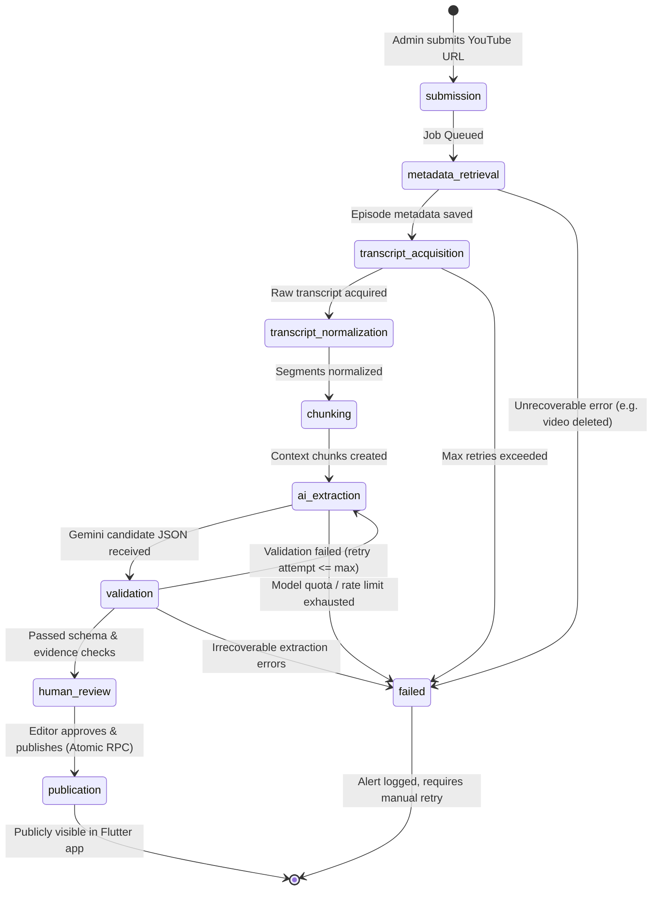

# Processing Job Lifecycle & Retry Matrix

## 1. Complete Lifecycle Overview

Every content ingestion workflow is tracked by a record in `processing_jobs`. The lifecycle consists of deterministic stages designed for sequential execution, fault tolerance, and isolated retries.



---

## 2. Stage Breakdown & Idempotency Rules

| Stage | Description | Idempotency & State Guarantee | Large Media Policy |
| :--- | :--- | :--- | :--- |
| **1. submission** | URL validated, YouTube Video ID extracted. Checked against `episodes.youtube_video_id` UNIQUE constraint. Initial `processing_jobs` row created. | **Idempotent**: Re-submitting same URL returns existing job ID or fails deduplication check before job spawn. | None. URL string only. |
| **2. metadata_retrieval** | YouTube Data API or metadata parser fetches title, channel, duration, description, thumbnail URL. Updates or creates draft in `episodes`. | **Idempotent**: `ON CONFLICT (youtube_video_id) DO UPDATE`. Overwrites draft metadata fields cleanly. | None. Stores metadata strings and external thumbnail URL. |
| **3. transcript_acquisition** | Checks for YouTube manual Amharic captions; falls back to automatic captions, or streams audio to private bucket for Whisper STT. | **Idempotent**: Overwrites temporary raw transcript buffer in storage or stages without touching production segments. | Raw audio downloaded directly to private object storage (`meri-media-raw/{job_id}.mp3`). Never stored in PostgreSQL. Auto-deleted after stage 4. |
| **4. transcript_normalization** | Parses raw subtitle/STT cues into strictly monotonic, non-overlapping `start_ms` and `end_ms` intervals with Unicode Amharic cleanup. Inserts into `transcript_segments`. | **Idempotent**: `DELETE FROM transcript_segments WHERE episode_id = $1` before bulk insertion of normalized segments. | Output is structured text in `transcript_segments`. |
| **5. chunking** | Synthesizes semantic context windows (800–1200 words, ~5–8 mins with 1-min overlap) referencing exact segment indices. Inserts into `transcript_chunks`. | **Idempotent**: `DELETE FROM transcript_chunks WHERE episode_id = $1` before bulk insertion of new chunks. | Text records only. |
| **6. ai_extraction** | Calls Gemini model with structured prompt, segment context, and JSON Schema contract. Saves raw response in `extraction_runs`. | **Idempotent**: Inserts a new row into `extraction_runs` with incremented `run_number`. Previous attempts preserved for auditability. | Text & JSON only. |
| **7. validation** | Dual-phase validator: (1) JSON schema verification; (2) Segment evidence reference integrity check. | **Idempotent**: Read-only evaluation against `extraction_runs`. Updates `validation_status` and `validation_errors`. | None. |
| **8. human_review** | Staged candidate insights and quotes populate admin dashboard. Editors review, edit wording, or reject candidate items. | **Idempotent**: State transitions per item (`candidate` -> `verified` / `rejected`). | None. |
| **9. publication** | Atomically validates minimum verified counts, checks evidence presence, and sets `episodes.publication_status = 'published'` via `publish_episode()` RPC. | **Idempotent**: Calling `publish_episode` on an already published episode is a safe no-op. | None. |

---

## 3. Failure Classification & Retry Strategy

### 3.1 Failure Categories

```
                             Failure Event
                                   │
              ┌────────────────────┴────────────────────┐
              ▼                                         ▼
      Transient Errors                          Permanent Errors
  (Automatic Retry with Backoff)              (Immediate Terminal Failure)
  - HTTP 429 Rate Limit (Gemini/YT)          - Invalid or Malformed YouTube URL
  - HTTP 500/503 Network Timeout             - Private / Region-Locked / Deleted Video
  - DB Connection Pool Exhaustion            - Duplicate Video ID Constraint Violation
  - Storage Upload Socket Hangup             - Hallucination / Schema Reject post max retry
```

### 3.2 Retry Algorithm & Exponential Backoff
For transient failures, the worker calculates backoff delay using exponential backoff with full jitter:

$$\text{delay} = \min(\text{max\_backoff}, \text{initial\_backoff} \times 2^{\text{retry\_count}}) \pm \text{random\_jitter}$$

- `initial_backoff`: 5 seconds
- `multiplier`: 2.0
- `max_backoff`: 300 seconds (5 minutes)
- `max_retries`: 3 attempts per stage

### 3.3 State Logging & Audit Metadata
When a stage transitions or fails, `processing_jobs` records:
- `current_stage`: Active stage enum.
- `retry_count`: Total attempts for the current stage.
- `error_summary`: Human-readable error message.
- `error_details`: Full JSON stack trace, HTTP status code, and upstream response body.
- `stage_timings`: JSON map recording:
  ```json
  {
    "metadata_retrieval": {"started_at": "...", "completed_at": "...", "duration_ms": 1420},
    "transcript_acquisition": {"started_at": "...", "completed_at": "...", "duration_ms": 12840},
    "ai_extraction": {"started_at": "...", "completed_at": "...", "duration_ms": 6120, "attempt": 1}
  }
  ```

---

## 4. Manual Intervention & Administrative Overrides

Admins can trigger manual retries or stage overrides via API:
1. **Force Retry**: `POST /api/v1/admin/jobs/{job_id}/retry` with `{"stage": "ai_extraction"}` forces re-execution from the specified stage without re-fetching metadata or transcripts.
2. **Transcript Manual Override**: `POST /api/v1/admin/jobs/{job_id}/transcript` allows uploading an official Amharic transcript, automatically resuming the pipeline at stage 4 (`transcript_normalization`).
