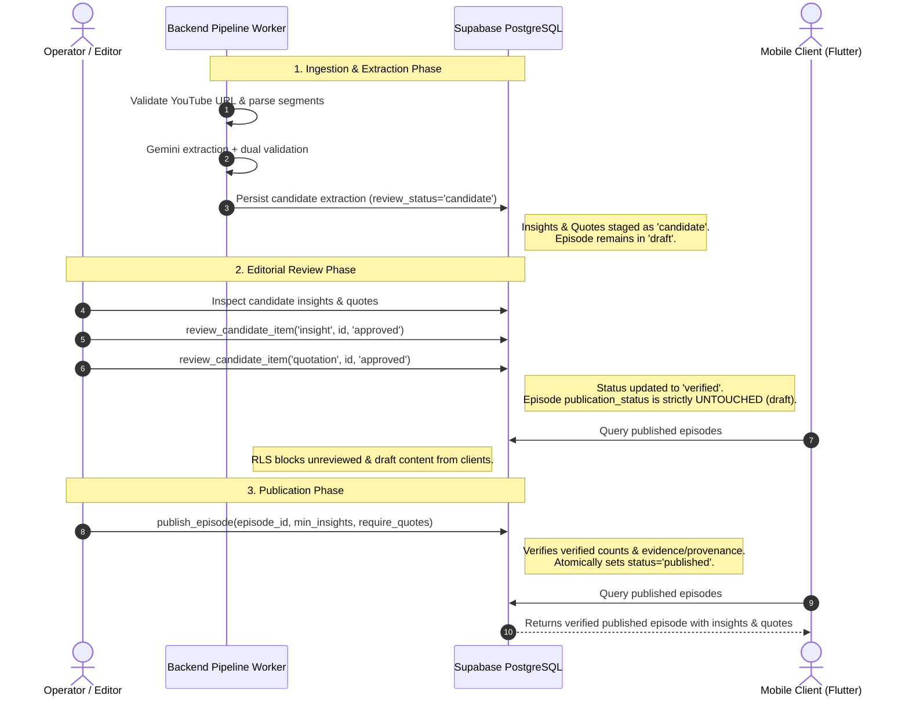

# Operator Workflow, Quotation Provenance & Migration Recovery Guide

## 1. Executive Summary

Milestone 3 implements the editorial review boundary and multi-segment quotation provenance for the Meri Content Pipeline.

Key architectural boundaries enforced:
1. **Relational Multi-Segment Provenance (`quotation_segments`)**: Eliminates lossy single-segment truncations by capturing contiguous spoken segments in deterministic sequence order with database uniqueness constraints and cross-episode integrity triggers.
2. **Strict Editorial Approval Boundary**: Automated AI extraction and validation strictly stages candidates with `review_status = 'candidate'`. Automated validation passing NEVER promotes candidates to `verified` or `approved`.
3. **Server-Side Authorization**: Editorial decisions are authorized strictly on the server/database layer (`current_user IN ('postgres', 'service_role')` or verified `app_metadata` claims). Client-supplied metadata or user-editable profile claims (`user_metadata`) are never trusted.
4. **Separation of Approval vs. Publication**: Marking items as approved/verified NEVER mutates the parent episode's publication status (`episodes.publication_status` remains `draft`). Publication remains gated behind the atomic `publish_episode()` RPC.
5. **Gemini Preflight Architecture**: Local model syntax validation is strictly separated from remote availability and structured-output capability checks. Zero network calls occur during app startup or test discovery, and API keys are never logged.

---

## 2. Operator & Editorial Workflow



### 2.1 Step-by-Step Operator Procedures

1. **Candidate Ingestion**:
   - Operator submits a YouTube interview URL via ingestion worker.
   - The worker parses monotonic transcript segments, generates context chunks, and invokes Gemini structured extraction.
   - Layer 1 (Syntactic) and Layer 2 (Semantic Evidence) validators verify schema conformance and verbatim segment grounding.
   - The worker calls `CandidatePersistenceService.persist_candidate_extraction()`.
   - **Guarantee**: Items are written to `insights` and `quotations` with `review_status = 'candidate'`.

2. **Editorial Inspection & Verification**:
   - The editor reviews candidate insights against source transcript segments.
   - The editor reviews candidate quotations, verifying the Amharic spoken phrasing and English translations across all linked segments.
   - For an approved item, the editor invokes:
     ```sql
     SELECT review_candidate_item(
         p_item_type := 'insight',
         p_item_id := '<INSIGHT_UUID>',
         p_decision := 'approved',
         p_reviewer_id := '<EDITOR_USER_UUID>'
     );
     ```
   - For a rejected item:
     ```sql
     SELECT review_candidate_item(
         p_item_type := 'quotation',
         p_item_id := '<QUOTATION_UUID>',
         p_decision := 'rejected',
         p_reviewer_id := '<EDITOR_USER_UUID>'
     );
     ```
   - **Boundary Enforcement**: This updates `review_status`, `reviewed_by`, and `reviewed_at`. It **DOES NOT** publish the episode.

3. **Atomic Publication**:
   - Once all required items have been verified and confirmed to have supporting transcript evidence and quotation provenance:
     ```sql
     SELECT publish_episode(
         p_episode_id := '<EPISODE_UUID>',
         p_admin_user_id := '<EDITOR_USER_UUID>',
         p_min_insights := 1,
         p_require_quotations := TRUE,
         p_min_quotations := 1
     );
     ```
   - The function verifies:
     - Episode exists and is locked (`FOR UPDATE`).
     - Minimum verified insight count is satisfied.
     - Minimum verified quotation count is satisfied.
     - All verified insights have relational citations in `insight_evidence`.
     - All verified quotations have relational provenance in `quotation_segments` (or starting anchor `segment_id`).
   - If all assertions pass, `episodes.publication_status` transitions atomically to `'published'` with `published_at = now()`.

---

## 3. Relational Multi-Segment Quotation Provenance

### 3.1 Schema Design (`quotation_segments`)

```sql
CREATE TABLE quotation_segments (
    id UUID PRIMARY KEY DEFAULT gen_random_uuid(),
    quotation_id UUID NOT NULL REFERENCES quotations(id) ON DELETE CASCADE,
    segment_id UUID NOT NULL REFERENCES transcript_segments(id) ON DELETE RESTRICT,
    sequence_order INT NOT NULL CHECK (sequence_order >= 0),
    created_at TIMESTAMPTZ NOT NULL DEFAULT now(),

    CONSTRAINT uq_quotation_segment UNIQUE (quotation_id, segment_id),
    CONSTRAINT uq_quotation_sequence_order UNIQUE (quotation_id, sequence_order)
);
```

### 3.2 Provenance Guarantees

1. **Compatibility Anchor**: `quotations.segment_id` continues to store the starting transcript segment ID. Existing Flutter mobile client models that deserialize `timestampSeconds` continue to function without disruption.
2. **Deterministic Sequence Ordering**: `sequence_order` (0, 1, 2...) orders multi-segment quotations spanning contiguous transcript cues.
3. **Uniqueness**:
   - `(quotation_id, segment_id)` prevents accidental duplicate linking of the same segment to a quotation.
   - `(quotation_id, sequence_order)` guarantees deterministic, collision-free ordering.
4. **Cross-Episode Integrity Triggers**:
   - `trg_check_quotation_segment_same_episode` rejects linking a segment from Episode B to a quotation from Episode A.
   - `trg_check_quotation_starting_segment_same_episode` rejects setting `quotations.segment_id` to a segment belonging to a different episode.
5. **Canonical Timestamps**: Derived strictly from `start_ms` of the first source segment (`start_ms // 1000`). Model-reported hallucinated timestamps are rejected or flagged.

---

## 4. Server-Side Editorial Authorization Model

### 4.1 Threat Model & Untrusted Metadata Prevention

| Layer | Implementation | Security Mechanism |
| :--- | :--- | :--- |
| **Database Server Roles** | `current_user IN ('postgres', 'service_role')` | Direct execution privileges for backend worker services and administrative CLI sessions. |
| **Supabase JWT Claims** | `(auth.jwt() ->> 'role') = 'admin'` OR `(auth.jwt() -> 'app_metadata' ->> 'is_admin')::boolean = true` | Only trusted claims injected into `app_metadata` by Supabase authentication admin API are honored. |
| **Untrusted Claims** | `auth.jwt() -> 'user_metadata'` | **EXPLICITLY REJECTED**. User-editable profile metadata can never grant editorial or administrative review rights. |
| **Public / Anon Access** | `REVOKE ALL ON FUNCTION review_candidate_item FROM anon, PUBLIC;` | Unauthenticated mobile clients and anon tokens cannot execute review operations. |

---

## 5. Gemini Preflight Verification Architecture

### 5.1 Local Syntax vs. Remote Preflight Separation

1. **Local Syntactic Validation**:
   - Evaluated by `validate_model_id_syntax(model_id: str)`.
   - Uses regex `^[a-zA-Z0-9_.-]{3,64}$`.
   - Purely synchronous in-memory string format verification.
   - Safe to run anywhere, anytime.

2. **Remote Preflight Verification**:
   - Evaluated by `verify_model_preflight(model_id, api_key, transport)`.
   - Verifies:
     1. Remote model exists (GET `/v1beta/models/{model_id}`).
     2. Model declares `generateContent` in `supportedGenerationMethods`.
     3. Model accepts structured output configuration (`responseMimeType: "application/json"`).
   - **Never run during app startup or unit tests**.
   - Executed strictly on-demand before real transcript extraction.

3. **Zero Secrets Logging Policy**:
   - All network transport error handlers wrap URLs with `_redact_secrets()`.
   - Replaces `key=...` with `key=[REDACTED]`.
   - API keys are never written to log files, terminal stdout, or exception strings.

---

## 6. Migration Rollback & Disaster Recovery Considerations

### 6.1 Safe Rollback Procedure

If Milestone 3 migration (`20261022000001_quotation_provenance_and_editorial_boundary.sql`) needs to be rolled back:

```sql
BEGIN;

-- 1. Revert publish_episode function to Milestone 2 baseline
CREATE OR REPLACE FUNCTION publish_episode(
    p_episode_id UUID,
    p_admin_user_id UUID DEFAULT NULL,
    p_min_insights INT DEFAULT 1,
    p_require_quotations BOOLEAN DEFAULT FALSE,
    p_min_quotations INT DEFAULT 0
)
RETURNS JSONB
LANGUAGE plpgsql
SECURITY DEFINER
SET search_path = public, auth, pg_temp
AS $$
DECLARE
    v_is_authorized BOOLEAN := FALSE;
    v_episode RECORD;
    v_verified_insights_count INT;
    v_verified_quotations_count INT;
    v_unsupported_insights_count INT;
    v_target_min_quotations INT;
    v_effective_min_insights INT;
    v_result JSONB;
BEGIN
    IF current_user IN ('postgres', 'service_role') THEN
        v_is_authorized := TRUE;
    ELSE
        IF (auth.jwt() ->> 'role') = 'admin' OR 
           (auth.jwt() -> 'app_metadata' ->> 'is_admin')::boolean = true OR
           (auth.jwt() -> 'app_metadata' ->> 'role') = 'admin' THEN
            v_is_authorized := TRUE;
        END IF;
    END IF;

    IF NOT v_is_authorized THEN
        RAISE EXCEPTION 'Access denied: only administrators or service_role can publish episodes.';
    END IF;

    SELECT * INTO v_episode FROM episodes WHERE id = p_episode_id FOR UPDATE;
    IF NOT FOUND THEN
        RAISE EXCEPTION 'Episode % not found.', p_episode_id;
    END IF;

    IF v_episode.publication_status = 'published' THEN
        RETURN jsonb_build_object(
            'success', true,
            'message', 'Episode is already published',
            'episode_id', p_episode_id,
            'published_at', v_episode.published_at
        );
    END IF;

    v_effective_min_insights := GREATEST(p_min_insights, 1);
    SELECT count(*) INTO v_verified_insights_count FROM insights WHERE episode_id = p_episode_id AND review_status = 'verified';
    IF v_verified_insights_count < v_effective_min_insights THEN
        RAISE EXCEPTION 'Publication rejected: episode has % verified insight(s), but at least % is required.',
            v_verified_insights_count, v_effective_min_insights;
    END IF;

    SELECT count(*) INTO v_verified_quotations_count FROM quotations WHERE episode_id = p_episode_id AND review_status = 'verified';
    v_target_min_quotations := CASE WHEN p_require_quotations AND p_min_quotations = 0 THEN 1 ELSE p_min_quotations END;
    IF v_verified_quotations_count < v_target_min_quotations THEN
        RAISE EXCEPTION 'Publication rejected: episode has % verified quotation(s), but % is required by policy.',
            v_verified_quotations_count, v_target_min_quotations;
    END IF;

    SELECT count(*) INTO v_unsupported_insights_count FROM insights ins
    WHERE ins.episode_id = p_episode_id AND ins.review_status = 'verified'
      AND NOT EXISTS (SELECT 1 FROM insight_evidence ev WHERE ev.insight_id = ins.id);
    IF v_unsupported_insights_count > 0 THEN
        RAISE EXCEPTION 'Publication rejected: % verified insight(s) lack supporting transcript evidence references.',
            v_unsupported_insights_count;
    END IF;

    UPDATE episodes SET publication_status = 'published', published_at = COALESCE(published_at, now()), updated_at = now() WHERE id = p_episode_id;

    RETURN jsonb_build_object(
        'success', true,
        'episode_id', p_episode_id,
        'title', v_episode.title,
        'status', 'published',
        'verified_insights', v_verified_insights_count,
        'verified_quotations', v_verified_quotations_count,
        'published_by', p_admin_user_id,
        'published_at', now()
    );
END;
$$;

-- 2. Drop review RPC function
DROP FUNCTION IF EXISTS review_candidate_item(TEXT, UUID, TEXT, UUID);

-- 3. Drop cross-episode triggers
DROP TRIGGER IF EXISTS trg_check_quotation_starting_segment_same_episode ON quotations;
DROP FUNCTION IF EXISTS check_quotation_starting_segment_same_episode();

DROP TRIGGER IF EXISTS trg_check_quotation_segment_same_episode ON quotation_segments;
DROP FUNCTION IF EXISTS check_quotation_segment_same_episode();

-- 4. Drop quotation_segments table
DROP TABLE IF EXISTS quotation_segments CASCADE;

COMMIT;
```

### 6.2 Data Integrity During Rollback

- **No Data Loss on Core Tables**: Dropping `quotation_segments` does NOT delete or mutate records in `quotations`, `insights`, `transcript_segments`, or `episodes`.
- **Anchor Intact**: `quotations.segment_id` retains the primary starting segment reference and `canonical_timestamp_seconds`.
- **Mobile Client Immunity**: Mobile Flutter clients consume public read-only views on `quotations` and `insights`. They do not read `quotation_segments` directly, ensuring zero downtime or breaking changes.
